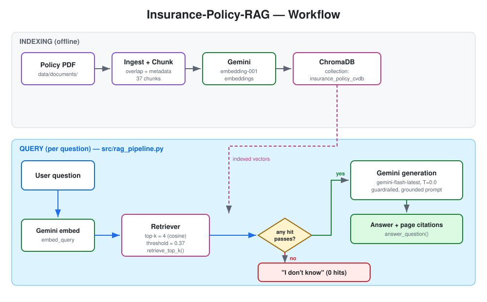

# Insurance-Policy-RAG

[](https://colab.research.google.com/github/arashshams/Insurance-Policy-RAG/blob/master/notebooks/03_insurance_policy_rag.ipynb)
[](https://insurance-policy-rag.streamlit.app/)

**A Retrieval-Augmented Generation (RAG) assistant that answers natural-language questions about a single insurance policy PDF — grounded in the document, cited by page, and honest enough to say "I don't know."**

Ask a question about your coverage; the system retrieves the most relevant passages from the policy, answers *only* from those passages with page citations, and explicitly abstains when the policy doesn't cover the question.



---

## Live demo

Try it now, no installation required: **[insurance-policy-rag.streamlit.app](https://insurance-policy-rag.streamlit.app/)**

Ask questions against the bundled sample policy, or upload your own policy PDF. Uploads are never written to disk and are cleared from memory when you switch files or after 30 idle minutes — but their text **is sent to Google's Gemini API** to be embedded and answered (see [Responsible AI](#responsible-ai)).

## Why this project

Understanding insurance coverage usually means scrolling through a long policy PDF or phoning the insurer. The information is there — it's just hard to locate and interpret. This project reduces that friction with a system that:

- Retrieves the relevant sections of a policy for each question
- Generates a clear, natural-language answer
- Grounds every answer in the source document, with citations
- Refuses to answer anything the policy text does not support

## What it does — and does not — do

**Does:** treats one policy document as the single source of truth, chunks it with overlap and metadata, embeds and stores it in a vector database, retrieves the most relevant passages per question, and generates a guardrailed answer with page citations.

**Does not:** give legal or financial advice, generalize across insurers or policy types, or interpret/extrapolate beyond the policy text.

## Architecture

The diagram above shows the full workflow. In short:

```
PDF -> text extraction -> chunking (overlap + metadata)
-> Gemini embeddings -> ChromaDB vector store
-> similarity retrieval (distance-thresholded)
-> guardrailed answer generation (with citations, or "I don't know")
```

The whole pipeline is consolidated into a single importable module, **`src/rag_pipeline.py`**, so notebooks, evaluation, and future apps all share one code path and one config block.

### Key configuration

| Setting | Value |
|---|---|
| Embedding model | `gemini-embedding-001` (3072-dim) |
| Generation model | `gemini-flash-latest` (temperature 0.0) |
| Vector store | ChromaDB, cosine space, collection `insurance_policy_cvdb` |
| Chunking | `cl100k_base` tokenizer, size 800, overlap 128 |
| Retrieval `k` | 4 (`K_DEFAULT`) |
| Distance threshold | 0.37 (cosine; lower = more similar), calibrated on the sample policy only |
| Upload-mode threshold | same as above unless `INSURANCE_RAG_UPLOAD_THRESHOLD` is set |
| Empty-retrieval behavior | short-circuits to "I don't know" |
| Citations | the model cites passage ids; pages come from the cited passages |

All values are env-overridable. The project root defaults to a Drive path but can be pointed anywhere with the `INSURANCE_RAG_ROOT` environment variable, and the whole project is designed to run within the Gemini **free tier**.

> **About the threshold.** 0.37 was calibrated on the bundled sample policy with the question set below. It is not known to transfer to other policies, so on an uploaded document "I don't know" may be stricter or looser than intended (the app says so). To calibrate a different policy, see [Calibrating your own policy](#calibrating-your-own-policy).

### Two runtime modes

- **Dev-persistent** — builds an on-disk Chroma index (plus an optional dev-only `chunks.json`) for local development.
- **App-ephemeral** — embeds an uploaded PDF into an in-memory Chroma collection and persists nothing, so a user's document is never written to disk (its text does go to the Gemini API for embedding and answering).

Both go through the same entry point: `build_index_from_pdf(source, persist_dir=...)`, which accepts either a file path or uploaded bytes.

## Pipeline interface

The module exposes these functions, which the notebooks, the evaluation harness, the app and the API all call. Every retrieval function takes the Chroma `collection` explicitly, so the same code serves the on-disk demo index and an in-memory upload:

- `build_index_from_pdf(source, persist_dir=None, ...)` -> `(collection, chunks)`. `source` is a path or uploaded bytes; `persist_dir=None` builds an in-memory index.
- `retrieve_top_k(collection, query, k=K_DEFAULT, threshold=DISTANCE_THRESHOLD)` -> a list of `{id, text, metadata, score}` for the passages that clear the threshold.
- `answer_question(collection, question, k=K_DEFAULT, model_name=GEN_MODEL, threshold=DISTANCE_THRESHOLD)` -> `(answer_text, pages, retrieved)`, returning `("I don't know", [], [])` when retrieval comes back empty. `pages` are the pages of the passages the model cited, and `[]` whenever the system abstains.
- `answer_question_detailed(...)` (same arguments) -> a dict with the above plus `abstained`, `cited_ids`, `citations_verified` (False when the model cited nothing and `pages` falls back to every retrieved passage), `nearest_distance` (closest passage *before* the threshold), and `model_resolved` (the model name the API reported; Gemini's endpoint currently echoes the requested name, so this pins down a version only if you request one).
- `is_abstention(answer)` -> the single definition of "the system said I don't know", used by the app, the API and the evaluation.

## Repository layout

```
api/
  main.py                           # FastAPI backend: GET /health, POST /ask
  README.md
app/
  streamlit_app.py                  # Streamlit UI (demo + upload modes)
  demo_index/                       # pre-built Chroma index of the SAMPLE policy
  README.md
img/
  architecture.svg                  # workflow diagram (shown above)
notebooks/
  01_document_ingestion.ipynb       # PDF ingest + chunking walkthrough
  02_embeddings_and_indexing.ipynb  # building a persistent Chroma index
  03_insurance_policy_rag.ipynb     # end-to-end walkthrough on the shared pipeline
  04_evaluation.ipynb               # notebook runner for src/evaluate.py
  eval/eval_questions.json          # eval set (12 in-scope, 6 out-of-scope)
  assets/                           # documentation images
src/
  rag_pipeline.py                   # the shared, importable pipeline
  evaluate.py                       # evaluation harness (CLI: python -m src.evaluate)
  guardrails.py                     # rate limiting + idle-upload cleanup
tests/                              # offline tests (no API key needed)
.github/workflows/tests.yml         # CI: runs the offline tests
.streamlit/config.toml              # Streamlit server settings (upload size cap)
data/
  documents/                        # local policy PDF (NOT committed — privacy)
requirements.txt
```

## Getting started

1. Install dependencies: `pip install -r requirements.txt`
2. Provide a Gemini API key (free-tier eligible) via your environment.
3. Place your policy PDF in `data/documents/` (optionally set `INSURANCE_RAG_ROOT`).
4. Run the notebooks in order (01 -> 02 -> 03), or import `src/rag_pipeline.py` directly and call `build_index_from_pdf(...)` then `answer_question(...)`.
5. Run the offline test suite (no API key needed): `pytest tests/`

### Programmatic use

```python
from src.rag_pipeline import build_index_from_pdf, answer_question

# persist_dir=None builds an in-memory index; pass a path to persist it on disk.
collection, chunks = build_index_from_pdf("data/documents/policy.pdf")
answer, pages, retrieved = answer_question(collection, "Is physiotherapy covered?")
```

`answer_question` returns the answer text, the cited pages, and the retrieved passages — or `("I don't know", [], [])` when nothing clears the threshold. Use `answer_question_detailed` for abstention, citation and distance details.

### Example questions

These are the exact wordings from the calibration eval set (`notebooks/eval/eval_questions.json`), also used as the app's one-click example buttons — verbatim, not paraphrased, per the policy in `app/streamlit_app.py`:

- Is physiotherapy covered under paramedical services?
- When is a Prior Authorization form needed?
- What expenses are excluded from health care benefits?

## Sample policy (for calibration)

Calibration and the numbers below were produced against a published, SAMPLE-watermarked medical contract (Manulife FlexCare, 32 pages), which ingestion splits into **37 chunks** on the original Colab environment (the shipped demo index at `app/demo_index/`, built locally with the same settings, has **38** — the ±1 comes from tokenizer/PDF-extractor versions). This document is only a stand-in for development; the real policy PDF is never committed. Answers are valid only for users covered by the same policy the index was built from.

## Evaluation (the quality story)

The pipeline is validated end-to-end on the free tier using an evaluation harness (`src/evaluate.py`, with `04_evaluation.ipynb` as a notebook runner). All metrics are deterministic (no LLM judge):

- **Guardrail:** out-of-scope abstention rate, judged with the same `is_abstention` rule the app and API use, and whether each abstention came from the distance threshold or the model's refusal.
- **Retrieval:** in-scope hit rate (anything passed the threshold) and page rate (a passage from the question's `expected_pages` was retrieved).
- **Answers:** citation page rate (the answer cited a passage on an expected page) and keyword rate (all expected keywords appear).
- **Headroom:** each question's closest-passage distance *before* the threshold, the gap between the worst in-scope and best out-of-scope question, and a suggested threshold.

Cached results expire after 14 days (`--max-age-days`), because the default model name is a moving alias and Gemini's OpenAI-compatible endpoint doesn't report which version served a request. Scoring is re-applied to cached answers on every run, so editing a question's expected keywords or pages doesn't need new API calls.

Latest run (October 2026, shipped 38-chunk demo index, `gemini-flash-latest`, 12 in-scope + 6 out-of-scope questions):

| Metric | Result |
|---|---|
| Out-of-scope abstention rate | **100%** (6 / 6) |
| In-scope retrieval hit rate | **100%** |
| In-scope questions answered | **12 / 12** |
| In-scope citation page rate | **100%** (every answer cited a passage on an expected page) |
| In-scope answer-keyword rate | **92%** (11 / 12; see below) |
| Closest-passage distance, in-scope max / out-of-scope min | 0.344 / 0.335 |

The one keyword miss (`in_07`) was a correct answer: it gave the $5 million per-incident travel limit from page 17 but didn't use the words "outside" and "age" that the old keyword list required. The keywords now check for that limit instead. Two in-scope questions sit fairly close to the 0.37 cutoff (`in_01` at 0.336, `in_06` at 0.344), so rewording them could tip them into "I don't know".

**How "I don't know" actually happens.** The guardrail has two layers, and this run shows both are needed:

1. **Distance threshold (0.37).** If no passage is close enough, the system says "I don't know" without calling the LLM. This stopped the four clearly unrelated questions (closest passages 0.397–0.503).
2. **The model's refusal.** The prompt tells Gemini to answer only from the passages it is given. The two near-miss questions (pet vet bills at 0.335; a Manulife mortgage question at 0.366) got past the threshold, but Gemini found no answer in the passages and said "I don't know".

No single threshold separates this question set: the pet question's closest passage (0.335) is nearer than four real questions' (up to 0.344). Lowering the cutoff enough to block it would reject real questions, so 0.37 stays, and the model's refusal is what handles questions that sound related but aren't covered. The evaluation summary reports how each out-of-scope question was stopped.

An earlier calibration run (37-chunk Colab index, the original 8 in-scope and 4 out-of-scope questions) answered 7 of 8 in-scope questions. The non-answer was correct by design: that question (`in_02`) then asked for a figure that lives in a separate Schedule of Benefits, not in this policy, and has since been reworded. With 18 questions on one sample policy, all of these figures are a small sample.

The harness evaluates the exact code and index the live app ships. To reproduce or refresh the numbers on the shipped 38-chunk demo index:

```bash
export GEMINI_API_KEY=...
python -m src.evaluate            # defaults to app/demo_index/; cached in notebooks/eval/eval_results.json
```

Evaluation runs are sequential and paced to stay within free-tier limits, and no real policy facts are committed.

### Calibrating your own policy

The threshold only means something for the document it was calibrated on. For another policy, write a small question set in the same JSON format (in-scope questions with `expected_keywords` and `expected_pages`, plus out-of-scope ones, ideally including near-misses), then run:

```bash
python -m src.evaluate --pdf my_policy.pdf --questions my_questions.json --results my_results.json
```

This builds an in-memory index of the PDF (one embedding pass), runs the questions, and prints the in-scope/out-of-scope distance gap with a suggested threshold. Apply it with `INSURANCE_RAG_UPLOAD_THRESHOLD` (app upload mode) or `INSURANCE_RAG_THRESHOLD` (everywhere). Keep private policies and their results out of the repo.

## Responsible AI

- Answers are grounded in retrieved document content and cited by page. Pages come from the passages the model actually cited; when it cites none, the app says the pages are those of all retrieved passages instead.
- The system returns "I don't know" when the information isn't present: either no passage is close enough (no LLM call is made), or the model finds no answer in the passages it was given.
- Scope and limitations are stated explicitly, including that the relevance threshold is calibrated on the sample policy only.
- **Privacy:** the real policy PDF is intentionally not in the repo, and no real policy contents are committed. Uploaded PDFs are never written to disk and are freed from memory when the user switches files or after 30 idle minutes (`INSURANCE_RAG_UPLOAD_TTL_MIN`). However, the text of an uploaded policy and each question **are sent to Google's Gemini API**, and on the free tier Google may use that content to improve its products. The app tells users this before they upload; don't use the free tier with documents containing real personal data.
- **Cost and abuse controls:** every question and upload spends the deployer's Gemini quota, so the app caps uploads (10 MB, 60 pages, 150 chunks), rate-limits questions and uploads per session and app-wide, and limits concurrent upload indexes. The API supports a bearer token (`INSURANCE_RAG_API_TOKEN`; set it for any public deployment), per-client and global rate limits, and a question length cap. All limits are environment variables; see `src/guardrails.py` and the Config section of `src/rag_pipeline.py`.

## Roadmap

**Shipped:** the Streamlit MVP (bundled-policy demo plus a user-upload mode with a per-session, ephemeral index) is live at the [demo link above](https://insurance-policy-rag.streamlit.app/), and a FastAPI backend exposing `POST /ask` over the same pipeline is in the repo (`api/`), ready to be wired in over HTTP.

**Possible next steps:** multi-document support (policy + amendments) and query logging / metrics.

## Contributions

Pull requests are welcome!

For major changes, please open an issue first to discuss what you would like to change or add.

## License

This project is released under the [MIT License](LICENSE).

---

*This project is a technical demonstration of RAG principles and responsible AI design. It is not a source of legal or financial advice.*
